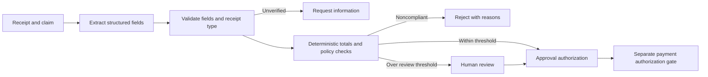

# Expense Agent Governance and Approval Controls

**Feras Elghandour** · System design, human review, and operational economics

An expense workflow can turn an incorrect receipt extraction into an incorrect reimbursement. This case study redesigns the boundaries between extraction, policy checks, approval, and payment authorization.

## Design



The design adds an illustrative 85% field-confidence threshold and a human-review gate for reports above $500. These are policy assumptions requiring calibration and organizational approval. Reviewers can approve, reject, request evidence, or partially approve line items. Payment authorization must remain a separate enforced service boundary.

## Deliverables and evidence

- [Architecture and control decisions](DESIGN.md): validation, review context, privacy controls, group expenses, and failure handling.
- `policy.py`: executable routing rules, exact-cent group allocation, and a parameterized monthly cost model.
- Six unit tests: threshold boundaries, missing verification, policy rejection, allocation conservation, cost arithmetic, and invalid inputs.

This is a design case study with a local policy prototype. No production expense platform, OCR accuracy result, payment integration, or measured business savings is claimed.

## Reproduce

Python 3.11 or later; no external dependencies:

```sh
python -m unittest discover -s tests -v
```

`monthly_cost(1000, .02, .1, 5, 60, 100)` returns **$620/month** under synthetic assumptions: 1,000 reports, $0.02 model cost each, 10% review, five minutes per review, $60/hour, and $100 fixed cost. This demonstrates the calculation, not a vendor quote or observed operating expense.

## Practical relevance

The case shows how to make agent recommendations reviewable before a financial action. Production work would require identity and permission checks, durable approval records, duplicate-payment protection, an idempotent payment service, security testing, and measured extraction calibration. The routing prototype has no capability to transfer funds.
